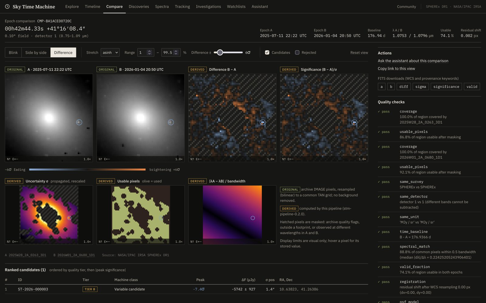

# Sky Time Machine

**Explore the universe. Travel through observations. Discover what changed.**

Sky Time Machine is an interactive time-domain explorer for **NASA/IPAC SPHEREx** observations. You can pick a
real position on the sky, see every archived SPHEREx exposure that covers it, compare two epochs taken at the
same wavelength, inspect the difference and its uncertainty, investigate ranked change candidates, and share
any view by URL.

All data come live from the [NASA/IPAC Infrared Science Archive (IRSA)](https://irsa.ipac.caltech.edu/Missions/spherex.html).
Nothing in the application is simulated: synthetic images exist only inside the test suite and are labelled as such.



## What works today

| Area | Status |
|---|---|
| Sky explorer (Aladin Lite, IRSA HiPS incl. SPHEREx DR1 all-sky cube, SPHEREx footprints, SIMBAD, name/coordinate search) | Working |
| Observation discovery (IRSA SIA2, `spherex_dr1`) and timeline of real exposure midpoints with coverage gaps | Working |
| Per-exposure wavelength at the target (FITS headers via HTTP Range + WCS-WAVE lookup) and spectrally matched pairs | Working |
| Cutout retrieval, FITS/WCS validation, registration, spectrally-matched differencing, EPSF-based PSF matching, uncertainty maps | Working |
| Candidate detection, artifact checks, explainable ranking, machine classes | Working (unvalidated science, see [LIMITATIONS](docs/LIMITATIONS.md)) |
| Blink comparator, side-by-side, difference grid, synced zoom/pan, stretch control, FITS downloads | Working |
| Discovery permalinks `/discovery/ST-YYYY-NNNNNN`, shareable explorer/compare URLs | Working |
| Forced photometry across spectrally matched epochs | Working (downloads ~4 MB per epoch) |
| Cross-comparison tracking (stationary / linear-motion linking) | Working on stored candidates |
| Sky Intelligence assistant | Rule-based without a key; Claude via server-side key (not exercised in CI) |
| Community annotations, moderation queue, audit log, reviewer verification | Working (shared-token moderation, no user accounts) |

## Quick start (macOS)

Requirements: Python ≥ 3.11 (tested 3.12), Node.js ≥ 20 (tested 26), internet access to `irsa.ipac.caltech.edu`.

```bash
python3.12 -m venv .venv
.venv/bin/pip install -e "backend[dev]"
(cd frontend && npm install)
cp .env.example .env            # optional; every setting has a default

# terminal 1 — API on :8000
cd backend && ../.venv/bin/uvicorn stm.main:app --port 8000
# terminal 2 — web app on :3000
cd frontend && npm run dev
```

Open <http://localhost:3000>, search for `M31`, open the timeline, pick a spectrally matched pair, and compare.

A ready-made real example (M31, detector 1, 177-day baseline):
`http://localhost:3000/compare?ra=10.6847&dec=41.269&det=1&a=2025W28_2A_0263_3D1&b=2026W01_2A_0680_1D1&size=0.1&mode=blink`

## Tests

```bash
cd backend && ../.venv/bin/pytest            # offline: synthetic + small real fixtures
cd backend && ../.venv/bin/pytest -m network # live IRSA integration (downloads ~16 MB)
cd frontend && npm test && npm run lint && npm run typecheck && npm run build
```

## Documentation

- [Architecture](docs/ARCHITECTURE.md) · [Data sources](docs/DATA_SOURCES.md) · [Scientific methodology](docs/SCIENTIFIC_METHODOLOGY.md)
- [Processing pipeline](docs/PROCESSING_PIPELINE.md) · [API](docs/API.md) · [Development](docs/DEVELOPMENT.md)
- [Limitations](docs/LIMITATIONS.md) · [Contributing](CONTRIBUTING.md)

## Acknowledgements

This project uses data from SPHEREx, a joint project of NASA's Jet Propulsion Laboratory and Caltech, served by
NASA/IPAC IRSA. Sky backgrounds: DSS2 and 2MASS HiPS (CDS, mirrored at IRSA). Sky viewer: Aladin Lite (CDS,
GPL-3). Name resolution: CDS Sesame. Scientific software: Astropy, NumPy, SciPy, reproject, photutils.
